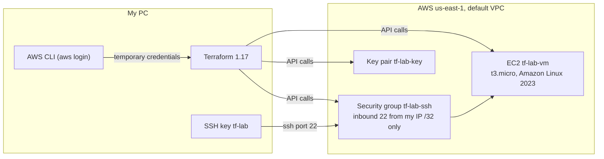
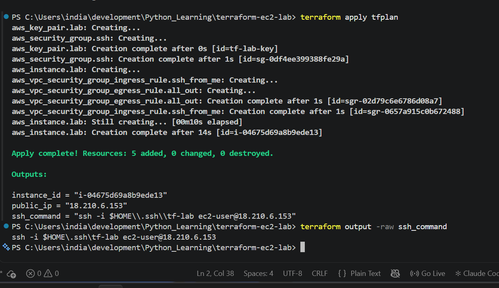
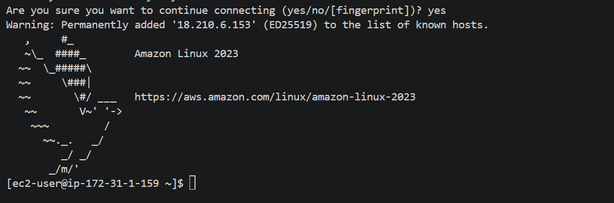

# Terraform EC2 Lab

Provision an AWS EC2 virtual machine with a security group that allows SSH from a single IP, entirely with Terraform. Built for the Infrastructure as Code topic of Learn to Cloud Phase 5, then torn down with one command.

## Objectives

- Define AWS infrastructure as code with providers, variables, data sources, resources and outputs
- Run the full Terraform lifecycle: `init`, `plan`, `apply`, `destroy`
- Apply secure defaults: SSH locked to one `/32`, IMDSv2 only, encrypted disk, no long-lived AWS access keys

## Architecture



## Resources

| Terraform resource | AWS resource | Purpose |
| --- | --- | --- |
| `aws_key_pair.lab` | Key pair `tf-lab-key` | Uploads my public SSH key |
| `aws_security_group.ssh` | Security group `tf-lab-ssh` | Firewall for the VM |
| `aws_vpc_security_group_ingress_rule.ssh_from_me` | Inbound rule | TCP 22 from my IP `/32` only |
| `aws_vpc_security_group_egress_rule.all_out` | Outbound rule | Updates and package installs |
| `aws_instance.lab` | EC2 `tf-lab-vm` | t3.micro, Amazon Linux 2023, gp3 8 GB encrypted, IMDSv2 |

Data sources look up the default VPC, its us-east-1a subnet and the latest Amazon Linux 2023 AMI from AWS's public Parameter Store path, so nothing is hardcoded.

## Project structure

```text
terraform-ec2-lab/
├── providers.tf               # Terraform + AWS provider versions, region, default tags
├── variables.tf               # Inputs with an IP /32 validation rule
├── main.tf                    # Data sources, key pair, security group + rules, EC2
├── outputs.tf                 # Instance ID, public IP, ready-to-paste SSH command
├── terraform.tfvars.example   # Copy to terraform.tfvars and fill in
├── .terraform.lock.hcl        # Pinned provider version (committed on purpose)
└── .gitignore                 # Keeps state, tfvars and plans out of git
```

## Prerequisites

- AWS account with an IAM user that can manage EC2 (no root)
- [Terraform](https://developer.hashicorp.com/terraform/install) 1.10 or newer
- [AWS CLI](https://docs.aws.amazon.com/cli/latest/userguide/getting-started-install.html) 2.32 or newer, signed in with `aws login`
- An SSH key pair: `ssh-keygen -t ed25519 -f ~/.ssh/tf-lab`

## Run it

```bash
aws login                                  # temporary credentials, no access keys stored
cp terraform.tfvars.example terraform.tfvars
# edit terraform.tfvars: my_ip_cidr = "<your IP>/32" (curl https://checkip.amazonaws.com)

terraform init
terraform fmt -check
terraform validate
terraform plan -out tfplan                 # expect: 5 to add, 0 to change, 0 to destroy
terraform apply tfplan
terraform output -raw ssh_command          # paste the printed command to connect
```

## Results

| Test | Expected | Result |
| --- | --- | --- |
| `terraform validate` | Configuration is valid | Pass |
| `terraform plan` | 5 to add, 0 to change, 0 to destroy | Pass |
| `terraform apply` | 5 added, outputs printed | Pass |
| SSH from my IP | Amazon Linux 2023 shell as `ec2-user` | Pass |
| `terraform destroy` | 5 destroyed, empty state | Pass |

**Apply:** 5 resources created in about 15 seconds, with outputs.



**SSH:** logged in to the Terraform-built VM with the key pair, from the allowed IP only.



## Security decisions

| Decision | Why |
| --- | --- |
| SSH from my IP `/32`, not `0.0.0.0/0` | Only one address on the internet can reach port 22 |
| `aws login` instead of access keys | Short-lived, auto-refreshing credentials; nothing to leak |
| `http_tokens = "required"` | IMDSv2 blocks SSRF-style metadata theft |
| Encrypted gp3 root volume | Data at rest is encrypted |
| `.gitignore` before any `.tf` file | State files and `terraform.tfvars` never reach git |
| Provider pinned `~> 6.0` + lock file | Reproducible builds, no surprise major upgrades |
| `lifecycle { ignore_changes = [ami] }` | A newer AMI does not silently replace the VM |

## Cost

About $0.02 per hour while running (t3.micro, public IPv4, 8 GB gp3) in us-east-1. Destroyed right after testing, so the total cost was under $0.05.

## Teardown

```bash
terraform destroy                          # expect: 5 to destroy
terraform state list                       # no output = everything removed
```

## Future improvements

- Store state remotely in S3 with `use_lockfile = true`
- Replace SSH with AWS Systems Manager Session Manager (no open ports)
- Run `fmt`, `validate` and `plan` in GitHub Actions using OIDC
- Package the VM and security group as a reusable module
